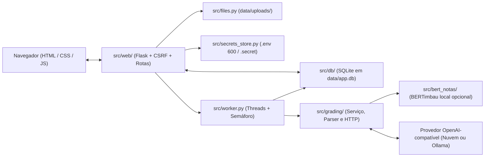
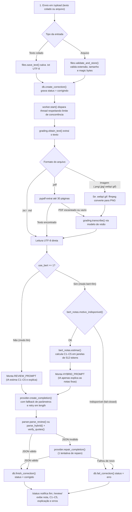
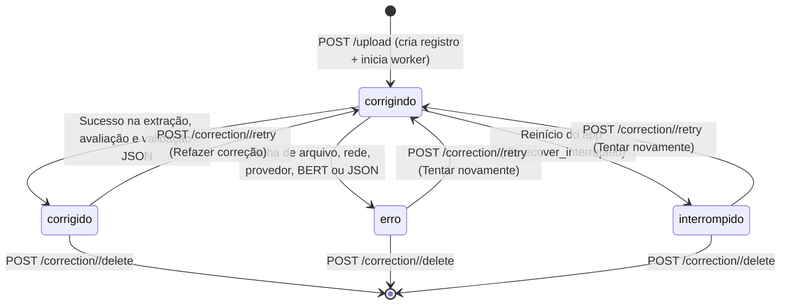
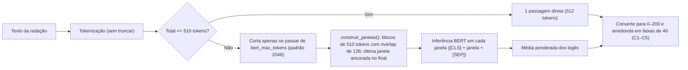

# DOCS — Pipeline Lógica do localRevisor

Este documento descreve, de forma visual e direta, como o **localRevisor** funciona de ponta a ponta: do envio da redação até a exibição da nota, passando por extração de texto, modo BERT (com janelas deslizantes), provedor de IA, validação JSON e persistência local.

---

## 1. Arquitetura em um olhar

---

## 2. Pipeline completa de uma correção

---

## 3. Ciclo de vida de uma correção

> Enquanto existe qualquer correção em `corrigindo`, a página inicial faz polling leve em `GET /status` (`src/static/progress.js`) e recarrega automaticamente ao concluir.

---

## 4. Fluxo de configuração e descoberta de modelos (`/config`)

```mermaid
sequenceDiagram
    actor U as Usuário
    participant W as /config (routes_config.py)
    participant S as secrets_store.py (.env)
    participant DB as SQLite (settings)
    participant P as Provedor (/models)

    U->>W: Seleciona preset ou digita URL base + chave e clica em "Conectar"
    W->>S: Salva OPENAI_API_KEY em .env (permissão 600)
    W->>P: GET {base_url}/models (Authorization: Bearer ...)
    P-->>W: JSON com lista real de modelos
    W->>DB: Salva base_url e lista de modelos (sem preenchimento arbitrário)
    W-->>U: Renderiza <select> com os modelos retornados (+ opção "Outro")
    U->>W: Escolhe modelo de correção, visão e opções do BERT e clica em "Salvar"
    W->>DB: Persiste configuração final
```

---

## 5. Pipeline do BERTimbau para redações longas

O checkpoint ajustado do BERTimbau possui janela nativa fixa de **512 tokens** (`max_position_embeddings = 512`). Para não descartar a conclusão (onde normalmente está a proposta de intervenção / C5), `src/bert_notas/inference.py` aplica **janelamento deslizante**:

- Se a redação cabe em `bert_max_tokens` (ajustável em `/config`: `512` a `8192`), o texto inteiro é lido e `truncated = False`.
- Se exceder `bert_max_tokens`, a revisão exibe o aviso indicando que é possível aumentar o limite em `/config`.

---

## 6. Mapa dos módulos (`src/`)

| Módulo / Pacote | Responsabilidade |
|---|---|
| `src/main.py` | Ponto de entrada Flask, carregamento de `.env`, `init_db()` e normalização inicial do BERT. |
| `src/web/__init__.py` | App factory `create_app()`. |
| `src/web/security.py` | Proteção CSRF, cabeçalhos de segurança (CSP, `X-Frame-Options`, etc.) e páginas 400/404/413/500. |
| `src/web/routes_corrections.py` | Rotas `/`, `/status`, `/upload`, `/review/<id>`, `/retry` e `/delete`. |
| `src/web/routes_config.py` | Rotas `/config` e `/config/baixar-bert`, presets de provedor e limite de tokens do BERT. |
| `src/web/feedback.py` | Formulário `/feedback`, validação, rate limit local e envio SMTP. |
| `src/worker.py` | Fila leve em threads com `BoundedSemaphore` (`LOCALREVISOR_MAX_WORKERS`). |
| `src/files.py` | Validação de upload (extensão, tamanho, UTF-8, magic bytes), leitura de PDF e conversão via `ffmpeg`. |
| `src/grading/models.py` | `ReviewResult`, `GradingError` e `ModelOutputError`. |
| `src/grading/prompts.py` | Prompts (`REVIEW_PROMPT`, `HYBRID_PROMPT`, `REPAIR_PROMPT`, `TRANSCRIBE_PROMPT`) e limites de tokens/timeout. |
| `src/grading/presets.py` | Catálogo de endpoints populares (OpenCode, Z.ai, Claude, Google AI, OpenAI, DeepSeek, OpenRouter, Groq, Ollama, LM Studio). |
| `src/grading/provider.py` | `GET /models`, cabeçalhos por provedor, fallback de parâmetros e retry automático em `finish_reason='length'`. |
| `src/grading/parser.py` | Extração de JSON, validação de notas ENEM (faixas de 40) e verificação de citações literais. |
| `src/grading/service.py` | Orquestração de `obtain_text()`, `transcribe()` e `review()`. |
| `src/bert_notas/validation.py` | Validação fail-closed do checkpoint (arquitetura, 5 saídas, `id2label` e dependências). |
| `src/bert_notas/inference.py` | Carregamento lazy com lock, janelas deslizantes (`construir_janelas`) e `estimar()`. |
| `src/bert_notas/download.py` | Download automático do checkpoint via `huggingface_hub.snapshot_download`. |
| `src/db/connection.py` | Conexão SQLite com `busy_timeout` e helpers de query/execução. |
| `src/db/schema.py` | Criação de tabelas, WAL e migrações idempotentes. |
| `src/db/settings.py` | Leitura e upsert da tabela `settings`. |
| `src/db/corrections.py` | CRUD de `corrections`, paginação, filtros, recuperação de jobs e serialização. |
| `src/paths.py` | Caminhos e limites configuráveis por variáveis de ambiente. |
| `src/secrets_store.py` | Gravação atômica da `OPENAI_API_KEY` em `.env` (`600`) e segredo de sessão em `data/.secret`. |

---

## 7. Garantias de segurança e resiliência

- **Local-first:** dados ficam em `data/app.db` (modo WAL) e `data/uploads/` (diretório `700`); chave de API nunca vai para o SQLite.
- **Proteções web:** CSRF obrigatório em todos os POSTs, `TRUSTED_HOSTS` restrito a loopback, CSP estrita (`script-src 'self' 'wasm-unsafe-eval'; style-src 'self'`) e validação de arquivos por magic bytes.
- **Fail-closed no BERT:** se o modo BERT estiver ligado sem checkpoint válido (e sem modo WebAssembly no cliente), a correção falha com mensagem clara em vez de inventar notas.
- **Recuperação automática:** jobs que estavam em `corrigindo` durante um reinício viram `interrompido` na inicialização e podem ser reexecutados com um clique.

---

## 8. Modo WebAssembly no cliente e Serviço NixOS

- **Inferência no hardware do usuário (`/config` → "Usar hardware (seu) para trabalhar com modelos"):** quando ativada, `src/static/upload.js` dispara `src/static/wasm_worker.js`, que carrega `src/static/model_score.wasm` e os pesos de `/wasm-model/weights.json` (`modelos/baseline_ridge/weights.json` ou pesos padrão), calcula `C1–C5` no navegador em WebAssembly e envia `client_scores` ao servidor — permitindo rodar o servidor hospedeiro sem PyTorch/BERT.
- **Pipeline de ML (`ml/pipeline.py`):** etapas automatizadas `collect` → `preprocess` → `train` → `evaluate` → `predict` (disponível também via `nix run .#ml-pipeline`).
- **Módulo NixOS (`nix/module.nix` / `nixosModules.default`):** expõe `services.localrevisor` com serviço `systemd` endurecido (`DynamicUser`, `StateDirectory`, `waitress`).
