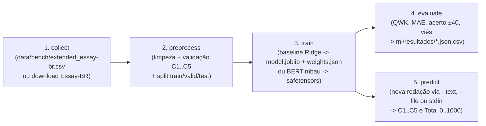

# Pipeline de ML do localRevisor

Esta pasta reúne a **pipeline automatizada de Machine Learning** do **localRevisor** para estimar as notas por competência (`C1` a `C5`, de `0` a `200` em faixas de `40` pontos) de redações no padrão ENEM.

## Estrutura de diretórios

```text
ml/
├── __init__.py
├── pipeline.py                  # CLI unificado: collect, preprocess, train, evaluate, run, predict
├── data/
│   ├── collect.py               # Coleta/carga (Essay-BR local, extended_essay-br.csv ou download)
│   ├── preprocess.py            # Limpeza, validação de notas e split train/valid/test
│   └── features.py              # Extração dos 8 atributos linguísticos (B1)
├── models/
│   ├── baseline.py              # B0 (moda) e B1 (StandardScaler + Ridge) + exportação de pesos WASM
│   └── bert.py                  # Fine-tuning e inferência com BERTimbau
├── eval/
│   ├── metrics.py               # QWK, qwk_por_competencia e teste de não regressão
│   ├── evaluate.py              # Tabelas por competência e relatórios JSON/CSV
│   └── compare.py               # Comparação B0, B1, BERTimbau e LLMs com IC 95% (bootstrap)
├── experiments/
│   ├── bert_experiments.py      # Experimentos de temas novos e sementes
│   └── llm_zero_shot.py         # Avaliação zero-shot via API compatível com OpenAI
└── resultados/                  # Relatórios e previsões gerados
```

## Fluxo automatizado



## Como executar (da raiz do repositório)

Com Nix (`nix develop` ou `nix run .#ml-pipeline`):

1. **Executar toda a pipeline automaticamente (Coleta → Pré-processamento → Treino → Avaliação):**

   ```bash
   python -m ml.pipeline run --model baseline
   # ou via Nix:
   nix run .#ml-pipeline -- run --model baseline
   ```

2. **Executar etapas individuais:**

   ```bash
   python -m ml.pipeline collect
   python -m ml.pipeline preprocess --seed 42
   python -m ml.pipeline train --model baseline
   python -m ml.pipeline evaluate --model baseline --split valid
   ```

   Para treinar o **BERTimbau** (recomendado com GPU):

   ```bash
   python -m ml.pipeline train --model bert --epochs 4 --seed 42
   python -m ml.pipeline evaluate --model bert --split valid
   ```

3. **Gerar predições para novas redações:**

   ```bash
   python -m ml.pipeline predict --model baseline --file "redacoes/A importância da prática de esportes_880.md" --json
   python -m ml.pipeline predict --model bert --text "Texto da redação..."
   ```

## Integração com WebAssembly no navegador

O comando `train --model baseline` exporta `modelos/baseline_ridge/weights.json`, consumido pelo Web Worker WebAssembly (`src/static/wasm_worker.js` + `src/static/model_score.wasm`) quando a opção **"Usar hardware (seu) para trabalhar com modelos"** está ativada em `/config`.
